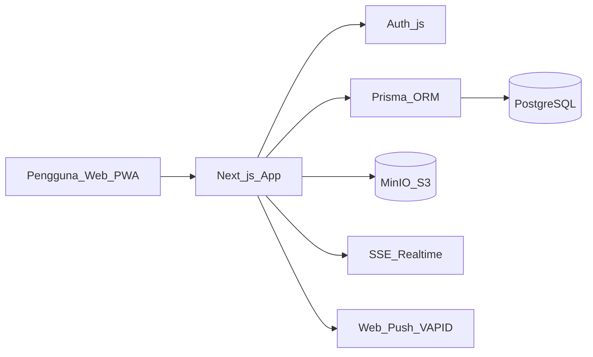
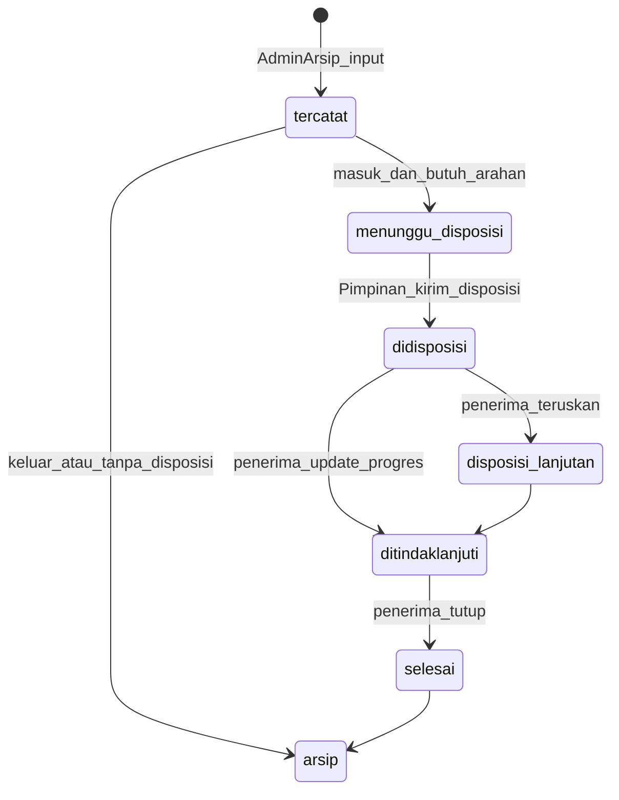
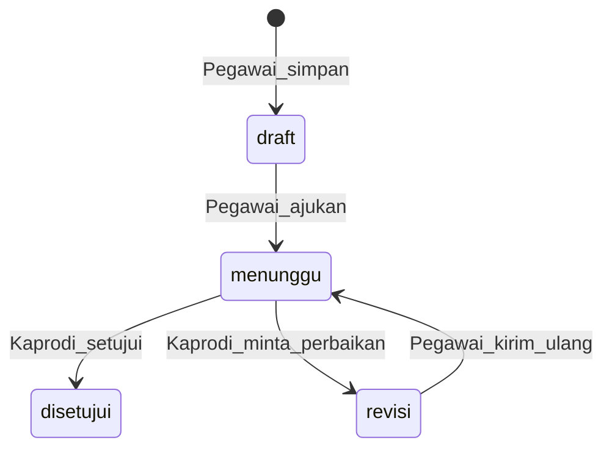

# PRODUCT REQUIREMENTS DOCUMENT (PRD)

## Sistem Informasi Persuratan, Disposisi Digital & Aktivitas Kepegawaian (Tridarma) Fakultas

| Meta | Nilai |
|------|--------|
| Versi dokumen | **v1.1 — Revised Blueprint** |
| Basis | v1.0 Final Blueprint (docx) |
| Target platform | Web & PWA (Android / iOS) |
| Framework utama | Next.js (App Router) + TypeScript |
| Cakupan pengguna | 5 role tingkat fakultas & prodi |
| Lingkungan acuan | Self-hosted (Laragon Node / VPS), **tanpa Supabase** |

---

## 1. Ringkasan Produk & Tujuan Sistem

Aplikasi ini adalah sistem informasi terpadu tingkat fakultas untuk mendigitalisasi dua proses administrasi inti:

1. **Persuratan & disposisi digital** — pencatatan, pengarsipan, disposisi, tindak lanjut, serta agenda/rekap surat masuk dan keluar.
2. **Aktivitas kepegawaian (Tridarma)** — pencatatan dan validasi kegiatan Pengajaran, Penelitian, dan Pengabdian kepada Masyarakat.

Sistem dibangun dengan Next.js (App Router), pendekatan mobile-first, pembaruan real-time selektif (SSE), dan Progressive Web App (PWA) agar dapat dipasang ke layar utama perangkat.

### 1.1 Tujuan bisnis

- Mengurangi ketergantungan pada arsip kertas dan disposisi manual.
- Menyediakan jejak audit disposisi dan validasi yang tidak mudah diubah.
- Mempercepat monitoring capaian Tridarma per pegawai, prodi, dan fakultas.
- Memberi pengalaman mobile yang layak dipakai pejabat dan pegawai di lapangan.

### 1.2 In scope (v1.1)

- Autentikasi, sesi, dan RBAC 5 role (+ flag Kaprodi).
- Modul persuratan (masuk/keluar), disposisi, tindak lanjut, pencarian, agenda & rekap.
- Modul aktivitas Tridarma, validasi Kaprodi, monitoring & rekap.
- Unggah berkas ke MinIO, notifikasi in-app, Web Push, PWA installable.
- Ekspor Excel (MVP) dan PDF (fase lanjut).

### 1.3 Out of scope (v1.1)

- Tanda tangan elektronik TTE / BSrE.
- Integrasi SIAKAD / SSO universitas pusat.
- Aplikasi native (React Native / Flutter).
- Multi-fakultas / multi-tenant.
- Backup otomatis terjadwal (kebijakan backup tetap didokumentasikan; eksekusi ops di luar app).
- OCR / klasifikasi AI isi surat.

---

## 2. Arsitektur Teknologi (Tech Stack Final)

Semua pilihan “atau” dari v1.0 **dikunci** sebagai berikut. Tidak ada alternatif di dokumen ini.

| Komponen | Spesifikasi |
|----------|-------------|
| Frontend & fullstack | Next.js (App Router), React, TypeScript |
| UI/UX | Tailwind CSS + shadcn/ui; mobile-first; navigasi drawer (desktop) / bottom-bar (mobile) |
| Database & ORM | PostgreSQL + Prisma ORM (self-hosted) |
| Autentikasi & RBAC | Auth.js (NextAuth v5) Credentials Provider; session strategy database atau JWT sesuai implementasi; proteksi **middleware + server action/API** |
| Real-time | Server-Sent Events (SSE) via Next.js Route Handlers untuk disposisi & perubahan status validasi |
| PWA | Web App Manifest, Service Worker (`@ducanh2912/next-pwa`), Web Push API (VAPID) |
| Penyimpanan berkas | MinIO (S3-compatible); metadata file di DB |
| Ekspor laporan | SheetJS / xlsx (Excel); `@react-pdf/renderer` (PDF Agenda & Rekap) |
| Hosting acuan | Node.js di Laragon (dev) / VPS dengan HTTPS (prod) |

### 2.1 Diagram konteks ringkas



---

## 3. Manajemen Pengguna & Matriks Hak Akses (RBAC)

### 3.1 Role

Sistem mengakomodasi **5 role** utama. Kaprodi **bukan** role terpisah: diakomodasi melalui `is_kaprodi = true` pada role `pegawai`.

| Role (enum) | Cakupan data | Tanggung jawab utama |
|-------------|--------------|----------------------|
| `super_admin` | Seluruh fakultas | Manajemen akun, role, flag Kaprodi, master data (prodi, kategori surat, tahun akademik/semester), konfigurasi sistem, override darurat ber-audit |
| `admin_arsip` | Seluruh fakultas | CRUD surat masuk/keluar, unggah arsip, pantau disposisi & overdue, pencarian, cetak/ekspor agenda & rekap surat |
| `admin_kepegawaian` | Seluruh fakultas | Master profil pegawai, pantau progres Tridarma per prodi, ekspor rekap kepegawaian |
| `pegawai` | Pribadi; Kaprodi: lingkup prodi | Input/edit aktivitas sendiri; jika `is_kaprodi`: validasi aktivitas pegawai di `prodi_id` yang sama |
| `pimpinan` | Seluruh fakultas | Disposisi surat masuk; modul kepegawaian **view-only** |

### 3.2 Jabatan struktural (pimpinan)

Role `pimpinan` dilengkapi `jabatan_struktural`:

| Nilai | Arti |
|-------|------|
| `dekan` | Dekan |
| `wd1` | Wakil Dekan I |
| `wd2` | Wakil Dekan II |
| `wd3` | Wakil Dekan III |

Wewenang **disposisi sama** untuk semua jabatan pimpinan. Filter dashboard dapat dikelompokkan per jabatan (mis. surat yang ditujukan ke WD tertentu), tetapi tidak membatasi hak membuat disposisi.

### 3.3 Aturan khusus

- **Tendik vs dosen:** keduanya dapat memakai role `pegawai`. Field `jenis_pegawai` (`dosen` | `tendik`) membatasi kategori Tridarma default:
  - `dosen`: pengajaran, penelitian, pengabdian.
  - `tendik`: pengabdian (+ kategori opsional `administrasi` jika diaktifkan Super Admin).
- **Ganti Kaprodi:** hanya `super_admin` yang mengubah `is_kaprodi`. Riwayat validasi lama tetap merujuk `divalidasi_oleh` / log historis.
- **Tindak lanjut disposisi:** hanya `tujuan_user_id` pada disposisi aktif yang dapat memperbarui progres dan menutup status. `admin_arsip` memantau overdue; tidak menutup atas nama penerima kecuali override `super_admin` + alasan audit.
- **Edit surat:** metadata surat terkunci setelah status mencapai `didisposisi` (atau lebih lanjut). Override hanya `super_admin` + alasan wajib di `audit_logs`.
- **Kepegawaian untuk pimpinan:** dashboard statistik, tabel detail, unduh rekap — tanpa create/update/delete aktivitas.

### 3.4 Matriks permission (halaman & aksi)

Legenda: C = Create, R = Read, U = Update, D = Delete/Soft-delete, V = Validate, X = Tidak diizinkan.

| Modul / aksi | super_admin | admin_arsip | admin_kepegawaian | pegawai | pegawai+kaprodi | pimpinan |
|--------------|:-----------:|:-----------:|:-----------------:|:-------:|:---------------:|:--------:|
| Master prodi / kategori / periode | CRUD | R | R | X | X | X |
| Manajemen user & role | CRUD | X | R profil terkait* | R diri | R diri | R diri |
| Flag `is_kaprodi` | U | X | X | X | X | X |
| Surat masuk/keluar | CRUD** | CRUD | X | X | X | R (+ filter) |
| Unggah arsip surat | Y | Y | X | X | X | X |
| Disposisi buat | Y** | X | X | X | X | C |
| Disposisi tindak lanjut | Y** | R pantau | X | jika penerima | jika penerima | jika penerima |
| Agenda & rekap surat | Y | Y | X | X | X | R/unduh |
| Aktivitas Tridarma sendiri | — | X | R pantau | CRUD terbatas*** | CRUD terbatas*** | R |
| Validasi aktivitas prodi | — | X | R pantau | X | V | R |
| Rekap kepegawaian | Y | X | Y | X | R prodi | R |
| Notifikasi | Y | Y | Y | Y | Y | Y |
| Audit log | R | X | X | X | X | X |
| Konfigurasi sistem / penomoran | U | X | X | X | X | X |

\* Admin kepegawaian mengelola master profil pegawai (data kepegawaian), bukan mengubah role sistem.  
\*\* Super admin untuk darurat/override, bukan alur harian.  
\*\*\* Pegawai: U/D hanya jika status `draft` atau `revisi`; ajukan mengubah ke `menunggu`.

### 3.5 Inventaris halaman (App Router)

| Path (usulan) | Role yang mengakses | Fungsi |
|---------------|---------------------|--------|
| `/login` | Publik | Autentikasi |
| `/` atau `/dashboard` | Semua terautentikasi | Ringkasan sesuai role |
| `/surat` | admin_arsip, pimpinan, super_admin | Daftar & filter surat |
| `/surat/baru` | admin_arsip, super_admin | Form input surat |
| `/surat/[id]` | sesuai hak R | Detail, arsip, riwayat disposisi |
| `/disposisi` | pimpinan, penerima, admin_arsip (pantau) | Antrean & tindak lanjut |
| `/agenda` | admin_arsip, pimpinan, super_admin | Buku agenda & ekspor |
| `/aktivitas` | pegawai (+kaprodi), admin_kepegawaian, pimpinan (R) | Daftar aktivitas |
| `/aktivitas/baru` | pegawai | Form input |
| `/aktivitas/[id]` | pemilik / validator / pantau | Detail & riwayat validasi |
| `/validasi` | pegawai dengan `is_kaprodi` | Panel validasi prodi |
| `/pegawai` | admin_kepegawaian, super_admin | Master profil |
| `/laporan/kepegawaian` | admin_kepegawaian, pimpinan, super_admin | Rekap Tridarma |
| `/master/*` | super_admin | Prodi, kategori, periode, konfigurasi |
| `/users` | super_admin | Akun & role |
| `/notifikasi` | semua | Pusat notifikasi |
| `/audit` | super_admin | Jejak audit |
| `/profil` | semua | Profil & preferensi push |

---

## 4. Spesifikasi Fitur & Alur Kerja

### 4.1 Modul Persuratan & Disposisi Digital

#### 4.1.1 Pencatatan surat

Admin Arsip menginput metadata:

- `jenis_surat`: `masuk` | `keluar`
- `kategori_surat_id` (FK master)
- `nomor_surat` (unik per jenis + tahun kalender; lihat §6.1)
- `tanggal_surat`, `tanggal_terima_kirim`
- `asal_tujuan`, `perihal`, `ringkasan`
- `butuh_disposisi` (boolean; default `true` untuk masuk, `false` untuk keluar)
- Berkas arsip: PDF / JPG / PNG → MinIO

Status awal setelah simpan:

- Surat **keluar** atau masuk tanpa disposisi → `tercatat` lalu dapat langsung `arsip`.
- Surat **masuk** dengan `butuh_disposisi = true` → `menunggu_disposisi`.

#### 4.1.2 Disposisi pimpinan

- Hanya surat **masuk** berstatus `menunggu_disposisi` (atau disposisi lanjutan) yang muncul di antrean pimpinan.
- Pimpinan memilih `tujuan_user_id` (**wajib**), `tujuan_jabatan` (opsional, label/filter), `catatan_disposisi`, `batas_waktu`.
- Setiap baris disposisi **immutable** setelah dibuat (tidak diedit; koreksi = disposisi baru / catatan tindak lanjut).
- Disposisi berantai: penerima dapat meneruskan ke user lain dengan `parent_disposisi_id`; **kedalaman maksimum = 5**.
- Real-time (Fase 2): SSE + notifikasi push ke penerima dan indikator antrean pimpinan.

#### 4.1.3 Tindak lanjut & pengarsipan

- Penerima memperbarui `status_tindak_lanjut`: `belum` → `proses` → `selesai` (atau `diteruskan` jika membuat disposisi anak).
- Setelah semua cabang disposisi aktif selesai (atau policy: disposisi root selesai), status surat → `selesai` / `arsip`.
- Admin Arsip memantau overdue (`batas_waktu` lewat, status belum `selesai`).

#### 4.1.4 State machine surat



Enum `surat.status`:

`tercatat` | `menunggu_disposisi` | `didisposisi` | `ditindaklanjuti` | `selesai` | `arsip`

Enum `disposisi.status_tindak_lanjut`:

`belum` | `proses` | `diteruskan` | `selesai` | `dibatalkan`

#### 4.1.5 Pencarian & laporan

- Pencarian: nomor, asal/tujuan, perihal, status, rentang tanggal, kategori.
- Ekspor Buku Agenda & Rekap: Mingguan / Bulanan / Tahunan.
  - Fase 1: Excel.
  - Fase 2: PDF berkop fakultas.

### 4.2 Modul Aktivitas Kepegawaian (Tridarma)

#### 4.2.1 Input mandiri

Pegawai menginput:

- `kategori`: `pengajaran` | `penelitian` | `pengabdian` (| `administrasi` jika diaktifkan)
- `judul_kegiatan`, `tanggal_kegiatan`, `periode_akademik_id` / semester
- `peran`: `ketua` | `anggota` | `pengampu` | `lainnya`
- `deskripsi`, bukti (`bukti_file` MinIO dan/atau `bukti_url` tautan)

#### 4.2.2 Validasi Kaprodi

- Hanya user `pegawai` dengan `is_kaprodi = true` melihat panel `/validasi` untuk pengajuan berstatus `menunggu` di `prodi_id` yang sama.
- Aksi: `disetujui` atau `revisi` (catatan wajib jika revisi).
- Setiap perubahan status ditulis ke `aktivitas_validasi_log` (append-only); kolom ringkas di `aktivitas_pegawai` di-update sebagai denormalisasi tampilan cepat.
- Pegawai dapat mengedit ulang hanya pada `draft` / `revisi`, lalu mengajukan kembali → `menunggu`.

#### 4.2.3 State machine aktivitas



Enum `aktivitas_pegawai.status_validasi`:

`draft` | `menunggu` | `revisi` | `disetujui` | `dibatalkan`

#### 4.2.4 Monitoring & rekap

- Admin Kepegawaian, Pimpinan (view-only), Super Admin: statistik & tabel detail per pegawai / prodi / fakultas.
- Ekspor rekap Mingguan / Bulanan / Tahunan (Excel Fase 1; PDF Fase 2).

### 4.3 PWA, notifikasi & real-time

| Fitur | Fase | Keterangan |
|-------|------|------------|
| Notifikasi in-app | 1 | Tabel `notifications`; badge di UI |
| SSE real-time | 2 | Update antrean disposisi & status validasi tanpa full reload |
| Web Push | 2 | VAPID + `push_subscriptions` |
| PWA installable | 2 | Manifest, SW, ikon, prompt “Install Aplikasi” |

Peristiwa notifikasi wajib:

1. Surat baru menunggu disposisi (ke pimpinan).
2. Disposisi baru / diteruskan (ke penerima).
3. Hasil validasi Kaprodi (ke pegawai).
4. Overdue tindak lanjut (ke penerima + Admin Arsip).

---

## 5. Rancangan Struktur Database

### 5.1 Prinsip

- Relasional PostgreSQL; integrity via FK + enum/check.
- Soft-delete: `deleted_at` pada `surat` dan `aktivitas_pegawai`.
- Timestamp: `created_at`, `updated_at` pada entitas utama.
- Disposisi & log validasi: **append-only** (tidak di-update isi instruksi/keputusan lama).
- Password: hash dikelola Auth.js / adapter; kolom kredensial mengikuti pola Auth.js (bukan menyimpan plain `password_hash` custom jika adapter sudah menyediakan).

### 5.2 Tabel master & pengguna

#### `prodi`

| Kolom | Tipe | Keterangan |
|-------|------|------------|
| id | UUID PK | |
| kode_prodi | VARCHAR UNIQUE | |
| nama_prodi | VARCHAR | |
| is_active | BOOLEAN | default true |
| created_at, updated_at | TIMESTAMPTZ | |

#### `tahun_akademik`

| Kolom | Tipe | Keterangan |
|-------|------|------------|
| id | UUID PK | |
| kode | VARCHAR UNIQUE | mis. `2025/2026` |
| tanggal_mulai, tanggal_selesai | DATE | |
| is_aktif | BOOLEAN | satu aktif dianjurkan |

#### `semester`

| Kolom | Tipe | Keterangan |
|-------|------|------------|
| id | UUID PK | |
| tahun_akademik_id | FK | |
| jenis | ENUM `ganjil` \| `genap` \| `pendek` | |
| label | VARCHAR | |
| is_aktif | BOOLEAN | |

#### `kategori_surat`

| Kolom | Tipe | Keterangan |
|-------|------|------------|
| id | UUID PK | |
| kode | VARCHAR UNIQUE | |
| nama | VARCHAR | |
| deskripsi | TEXT nullable | |
| is_active | BOOLEAN | |

#### `users`

| Kolom | Tipe | Keterangan |
|-------|------|------------|
| id | UUID PK | selaras Auth.js User |
| nidn_nip | VARCHAR UNIQUE | |
| nama | VARCHAR | |
| email | VARCHAR UNIQUE | |
| role | ENUM | `super_admin` \| `admin_arsip` \| `admin_kepegawaian` \| `pegawai` \| `pimpinan` |
| jenis_pegawai | ENUM nullable | `dosen` \| `tendik` (wajib jika pegawai) |
| jabatan_struktural | ENUM nullable | `dekan` \| `wd1` \| `wd2` \| `wd3` |
| prodi_id | FK nullable | wajib untuk pegawai/kaprodi |
| is_kaprodi | BOOLEAN | default false |
| is_active | BOOLEAN | |
| created_at, updated_at | TIMESTAMPTZ | |

Tabel Auth.js standar (`accounts`, `sessions`, `verification_tokens`) mengikuti adapter Prisma Auth.js.

### 5.3 Persuratan

#### `surat`

| Kolom | Tipe | Keterangan |
|-------|------|------------|
| id | UUID PK | |
| jenis_surat | ENUM `masuk` \| `keluar` | |
| kategori_surat_id | FK nullable | |
| nomor_surat | VARCHAR | unik bersama jenis + tahun |
| tahun_nomor | INT | tahun kalender untuk constraint unik |
| tanggal_surat | DATE | |
| tanggal_terima_kirim | DATE | |
| asal_tujuan | VARCHAR | |
| perihal | VARCHAR | |
| ringkasan | TEXT | |
| butuh_disposisi | BOOLEAN | |
| file_arsip_key | VARCHAR nullable | object key MinIO |
| file_arsip_mime | VARCHAR nullable | |
| file_arsip_size | INT nullable | bytes |
| file_arsip_checksum | VARCHAR nullable | |
| status | ENUM | lihat §4.1.4 |
| created_by | FK users | |
| created_at, updated_at | TIMESTAMPTZ | |
| deleted_at | TIMESTAMPTZ nullable | soft-delete |

**Unique:** `(jenis_surat, tahun_nomor, nomor_surat)` WHERE `deleted_at IS NULL`.

#### `disposisi`

| Kolom | Tipe | Keterangan |
|-------|------|------------|
| id | UUID PK | |
| surat_id | FK | |
| parent_disposisi_id | FK nullable | rantai |
| depth | INT | 1..5 |
| dari_user_id | FK | |
| tujuan_user_id | FK | **wajib** |
| tujuan_jabatan | VARCHAR nullable | label |
| catatan_disposisi | TEXT | |
| batas_waktu | DATE nullable | |
| status_tindak_lanjut | ENUM | lihat §4.1.4 |
| catatan_tindak_lanjut | TEXT nullable | |
| selesai_at | TIMESTAMPTZ nullable | |
| created_at | TIMESTAMPTZ | tidak ada update isi instruksi |

### 5.4 Kepegawaian / Tridarma

#### `aktivitas_pegawai`

| Kolom | Tipe | Keterangan |
|-------|------|------------|
| id | UUID PK | |
| user_id | FK | pemilik |
| prodi_id | FK | denormalisasi dari user saat create |
| kategori | ENUM | `pengajaran` \| `penelitian` \| `pengabdian` \| `administrasi` |
| judul_kegiatan | VARCHAR | |
| tanggal_kegiatan | DATE | |
| semester_id | FK nullable | |
| peran | ENUM | `ketua` \| `anggota` \| `pengampu` \| `lainnya` |
| deskripsi | TEXT | |
| bukti_file_key | VARCHAR nullable | |
| bukti_file_mime | VARCHAR nullable | |
| bukti_file_size | INT nullable | |
| bukti_url | VARCHAR nullable | |
| status_validasi | ENUM | lihat §4.2.3 |
| catatan_validator | TEXT nullable | ringkas last |
| divalidasi_oleh | FK nullable | last |
| divalidasi_at | TIMESTAMPTZ nullable | last |
| created_at, updated_at | TIMESTAMPTZ | |
| deleted_at | TIMESTAMPTZ nullable | |

#### `aktivitas_validasi_log`

| Kolom | Tipe | Keterangan |
|-------|------|------------|
| id | UUID PK | |
| aktivitas_id | FK | |
| dari_status | ENUM | |
| ke_status | ENUM | |
| validator_id | FK nullable | null jika aksi pegawai (ajukan) |
| catatan | TEXT nullable | |
| created_at | TIMESTAMPTZ | append-only |

### 5.5 Notifikasi, push, audit, konfigurasi

#### `notifications`

| Kolom | Tipe | Keterangan |
|-------|------|------------|
| id | UUID PK | |
| user_id | FK | |
| tipe | VARCHAR | mis. `disposisi_baru`, `validasi_hasil`, `overdue` |
| judul | VARCHAR | |
| pesan | TEXT | |
| link_path | VARCHAR nullable | deep link in-app |
| read_at | TIMESTAMPTZ nullable | |
| created_at | TIMESTAMPTZ | |

#### `push_subscriptions`

| Kolom | Tipe | Keterangan |
|-------|------|------------|
| id | UUID PK | |
| user_id | FK | |
| endpoint | TEXT UNIQUE | |
| p256dh | TEXT | |
| auth | TEXT | |
| user_agent | VARCHAR nullable | |
| created_at | TIMESTAMPTZ | |

#### `audit_logs`

| Kolom | Tipe | Keterangan |
|-------|------|------------|
| id | UUID PK | |
| actor_id | FK | |
| aksi | VARCHAR | mis. `user.role_change`, `surat.override_edit`, `disposisi.force_close` |
| entitas | VARCHAR | |
| entitas_id | UUID nullable | |
| sebelum | JSONB nullable | |
| sesudah | JSONB nullable | |
| alasan | TEXT nullable | wajib untuk override |
| created_at | TIMESTAMPTZ | |

#### `system_settings`

| Kolom | Tipe | Keterangan |
|-------|------|------------|
| key | VARCHAR PK | mis. `surat.nomor_format` |
| value | JSONB / TEXT | |
| updated_at | TIMESTAMPTZ | |
| updated_by | FK nullable | |

### 5.6 ER ringkas

```mermaid
erDiagram
  prodi ||--o{ users : has
  users ||--o{ surat : creates
  kategori_surat ||--o{ surat : classifies
  surat ||--o{ disposisi : has
  users ||--o{ disposisi : from
  users ||--o{ disposisi : to
  disposisi ||--o{ disposisi : parent
  users ||--o{ aktivitas_pegawai : owns
  prodi ||--o{ aktivitas_pegawai : scope
  semester ||--o{ aktivitas_pegawai : period
  aktivitas_pegawai ||--o{ aktivitas_validasi_log : history
  users ||--o{ notifications : receives
  users ||--o{ push_subscriptions : has
  users ||--o{ audit_logs : acts
```

---

## 6. Aturan Penomoran, Berkas & NFR

### 6.1 Penomoran surat internal

- Format default (konfigurasi `system_settings.surat.nomor_format`):

  `SURAT/{JENIS}/{TAHUN}/{SEQ}`

  Contoh SEQ numerik berpadding: `SURAT/M/2026/000123`.

- `{JENIS}`: `M` = masuk, `K` = keluar (atau label yang dikonfigurasi).
- Unik: `(jenis_surat, tahun_nomor, nomor_surat)`.
- Nomor eksternal dari instansi lain tetap dapat diisi manual pada field `nomor_surat` untuk surat masuk; generator internal opsional (toggle di form).
- Penyesuaian format final dapat dilakukan saat review prototipe dengan pimpinan tanpa mengubah constraint unik.

### 6.2 Unggah berkas

| Aturan | Nilai |
|--------|--------|
| Tipe diizinkan | `application/pdf`, `image/jpeg`, `image/png` |
| Ukuran maks | 10 MB per file |
| Validasi | MIME server-side (bukan hanya ekstensi) |
| Penyimpanan | MinIO bucket terpisah `surat` / `bukti-aktivitas` |
| Naming object | `{bucket}/{yyyy}/{mm}/{uuid}-{safeFilename}` |

### 6.3 Keamanan

- HTTPS wajib di produksi (PWA & Push bergantung pada secure context).
- Auth.js: proteksi CSRF bawaan untuk flow auth; cookie httpOnly / secure / sameSite.
- Rate limit login (mis. 5 gagal / 15 menit per IP+email).
- RBAC ditegakkan di **middleware** (pagar kasar) dan **server actions / Route Handlers** (pagar halus + scope prodi).
- Tidak mengekspos object MinIO publik tanpa URL bertanda tangan (presigned) berumur pendek.
- Override Super Admin wajib `alasan` → `audit_logs`.

### 6.4 Performa & kapasitas acuan

- Target respons halaman daftar (server) < 2s pada dataset 10k surat (dengan pagination & index).
- Index disarankan: `surat(status)`, `surat(tanggal_surat)`, `disposisi(tujuan_user_id, status_tindak_lanjut)`, `aktivitas_pegawai(prodi_id, status_validasi)`, `notifications(user_id, read_at)`.
- SSE: satu koneksi per tab terautentikasi; heartbeat periodik; fallback polling 30s jika SSE gagal.

### 6.5 Retensi & backup (kebijakan dokumen)

- Arsip surat digital: retensi minimum sesuai kebijakan fakultas (default usulan **7 tahun**); penghapusan hard hanya lewat prosedur admin + audit.
- Soft-delete dapat di-purge setelah masa retensi oleh job terpisah (bukan MVP).
- Backup PostgreSQL + MinIO: jadwal operasional di luar aplikasi (dokumentasikan di runbook deploy).

### 6.6 Aksesibilitas & UX

- Mobile-first; target usable pada lebar 360px.
- Kontras teks mengikuti praktik WCAG AA untuk komponen inti (form, status, CTA).
- Status disposisi/validasi memakai label teks + warna (bukan warna saja).

---

## 7. Fase Rilis & Acceptance Criteria

### 7.1 Fase 1 — MVP

**Cakupan**

- Auth.js credentials + RBAC middleware/API.
- Master: prodi, kategori surat, tahun akademik/semester, user.
- CRUD surat + unggah MinIO + constraint nomor.
- Disposisi **1 tingkat** + log immutable + tindak lanjut oleh penerima.
- Aktivitas Tridarma + validasi Kaprodi + `aktivitas_validasi_log`.
- Notifikasi in-app.
- Agenda/rekap Excel dasar (periode filter).
- UI mobile-first (shadcn/ui).

**Acceptance Criteria Fase 1**

1. Pengguna hanya mengakses route/aksi sesuai matriks §3.4; uji silang minimal 1 skenario per role.
2. Kaprodi hanya memvalidasi aktivitas `prodi_id` yang sama; uji coba lintas prodi ditolak.
3. Pimpinan view-only pada modul kepegawaian (tidak ada tombol ubah/hapus).
4. Surat masuk `butuh_disposisi` masuk antrean; disposisi mencatat pemberi, penerima, waktu, catatan.
5. Pegawai siklus `draft → menunggu → revisi → menunggu → disetujui` tersimpan di log.
6. Ekspor Excel agenda surat & rekap aktivitas untuk satu rentang tanggal berhasil diunduh.
7. File > 10 MB atau MIME tidak valid ditolak server.

### 7.2 Fase 2 — Real-time, PWA, PDF, disposisi berantai

**Cakupan**

- Disposisi berantai (`parent_disposisi_id`, max depth 5).
- SSE untuk update status.
- Web Push + `push_subscriptions`.
- PWA installable (manifest + SW).
- PDF agenda/rekap berkop.

**Acceptance Criteria Fase 2**

1. Penerima dapat meneruskan disposisi hingga depth 5; depth 6 ditolak.
2. Perubahan disposisi/validasi terlihat di klien penerima tanpa reload penuh (SSE) dalam kondisi jaringan normal.
3. Push terkirim (atau masuk antrean gagal yang terlihat di log) untuk 4 peristiwa §4.3.
4. Aplikasi dapat di-install ke home screen di Chrome Android; manifest & SW aktif di HTTPS.
5. PDF agenda memuat kop & data periode yang dipilih.

### 7.3 Fase 3 — Analitik & penguatan operasional

**Cakupan**

- Dashboard analitik (tren surat, SLA disposisi, capaian Tridarma).
- Overdue SLA & pengingat terjadwal.
- UI audit log untuk Super Admin.
- Field tambahan spesifik per kategori Tridarma (setelah review prototipe).

**Acceptance Criteria Fase 3**

1. Dashboard menampilkan metrik yang disepakati (minimal: jumlah surat per status, rata-rata hari tindak lanjut, jumlah aktivitas per kategori/prodi).
2. Overdue menghasilkan notifikasi sesuai jadwal job.
3. Audit log menampilkan aksi override dengan alasan.
4. Form Tridarma menampilkan field tambahan sesuai kategori tanpa merusak data lama.

---

## 8. Kriteria Keberhasilan Global (seluruh rilis)

| ID | Kriteria | Cara verifikasi |
|----|----------|-----------------|
| AC-RBAC | Kepatuhan matriks hak akses | Test case per role + negative test |
| AC-RT | Sinkronisasi real-time disposisi & validasi | Uji SSE Fase 2 |
| AC-RPT | Agenda & rekap Mingguan/Bulanan/Tahunan PDF+Excel | Unduh & spot-check isi |
| AC-PWA | HTTPS + Manifest + SW; installable | Lighthouse PWA / uji perangkat |
| AC-AUD | Jejak disposisi & validasi tidak tertimpa | Inspect DB log tables |

---

## 9. Catatan Implementasi

- Detail kop PDF, urutan kolom Excel, dan copy UI bahasa Indonesia dapat disesuaikan saat review prototipe dengan pimpinan fakultas **tanpa** mengubah state machine atau constraint unik yang dikunci di dokumen ini.
- Field spesifik tambahan per jenis kegiatan Tridarma dijadwalkan di Fase 3 agar MVP tidak tertunda.
- Dokumen ini menggantikan ambiguitas tech stack v1.0 untuk keperluan implementasi self-hosted Next.js + PostgreSQL + MinIO.

---

## Lampiran A — Perubahan vs PRD v1.0

| Area | v1.0 | v1.1 (revisi) |
|------|------|----------------|
| Tech stack | Banyak opsi (Supabase / Pusher / NextAuth atau …) | **Dikunci:** Next.js, PostgreSQL+Prisma, Auth.js, SSE, MinIO, `@ducanh2912/next-pwa`, SheetJS + `@react-pdf/renderer` |
| Supabase | Disebut sebagai opsi DB/Auth/Realtime/Storage | **Dihapus** dari arsitektur |
| Realtime | Supabase / Pusher / WebSockets generik | **SSE** Route Handlers |
| Role Kaprodi | Flag `is_kaprodi` (sudah ada) | Diperjelas: ganti flag, scope prodi, bukan role terpisah |
| Dekan vs WD | Digabung “Pimpinan” tanpa rinci | `jabatan_struktural` enum + wewenang disposisi sama |
| Tendik | Disebut sekilas | `jenis_pegawai` + batasan kategori Tridarma |
| Disposisi | 1 langkah implisit; `tujuan_user_id` nullable | `tujuan_user_id` **wajib**; rantai max depth 5; state machine lengkap |
| Tindak lanjut | Status di field, penutup tidak jelas | Penerima menutup; Admin Arsip pantau overdue; override ber-audit |
| Validasi history | Kolom overwrite di `aktivitas_pegawai` | + tabel `aktivitas_validasi_log` append-only |
| Master data | Disebut di narasi Super Admin | Tabel `kategori_surat`, `tahun_akademik`, `semester`, `system_settings` |
| Notifikasi / Push | Disebut fitur tanpa skema | `notifications`, `push_subscriptions` |
| Audit | Tidak ada | `audit_logs` + alasan override |
| File metadata | Hanya URL | key, mime, size, checksum + aturan 10 MB |
| Unik nomor surat | Tidak eksplisit | Unik per `(jenis_surat, tahun_nomor, nomor_surat)` |
| Penomoran | “bisa disesuaikan nanti” saja | Format default `SURAT/{JENIS}/{TAHUN}/{SEQ}` + settings |
| Edit surat | Tidak diatur | Terkunci setelah `didisposisi` |
| Out of scope | Tidak eksplisit | TTE, SIAKAD, native, multi-fakultas, OCR |
| Fase rilis | Semua fitur setara “final” | Fase 1 MVP / 2 PWA-realtime / 3 analitik |
| Acceptance | 4 butir umum | Terukur per fase + tabel AC global |
| Format dokumen | DOCX | Markdown di repo (`PRD_..._v1.1.md`) agar mudah di-review |

### Keputusan desain yang sengaja dikunci di v1.1

1. Self-hosted tanpa Supabase.
2. Disposisi hanya untuk surat masuk yang `butuh_disposisi`.
3. Depth disposisi maksimum 5.
4. Unik nomor surat per jenis + tahun kalender.
5. Soft-delete pada surat & aktivitas.
6. Excel di MVP; PDF & PWA/Push di Fase 2.

---

## Lampiran B — Glosarium singkat

| Istilah | Arti |
|---------|------|
| Disposisi | Instruksi pimpinan atas surat masuk kepada penerima tertentu |
| Tridarma | Pengajaran, Penelitian, Pengabdian |
| Kaprodi | Ketua Program Studi (`is_kaprodi`) |
| SSE | Server-Sent Events — saluran server→klien satu arah |
| Presigned URL | URL sementara untuk unduh/unggah object MinIO |
| Soft-delete | Tandai `deleted_at` tanpa hapus fisik baris |

---

*Akhir dokumen PRD v1.1 — Revised Blueprint.*
